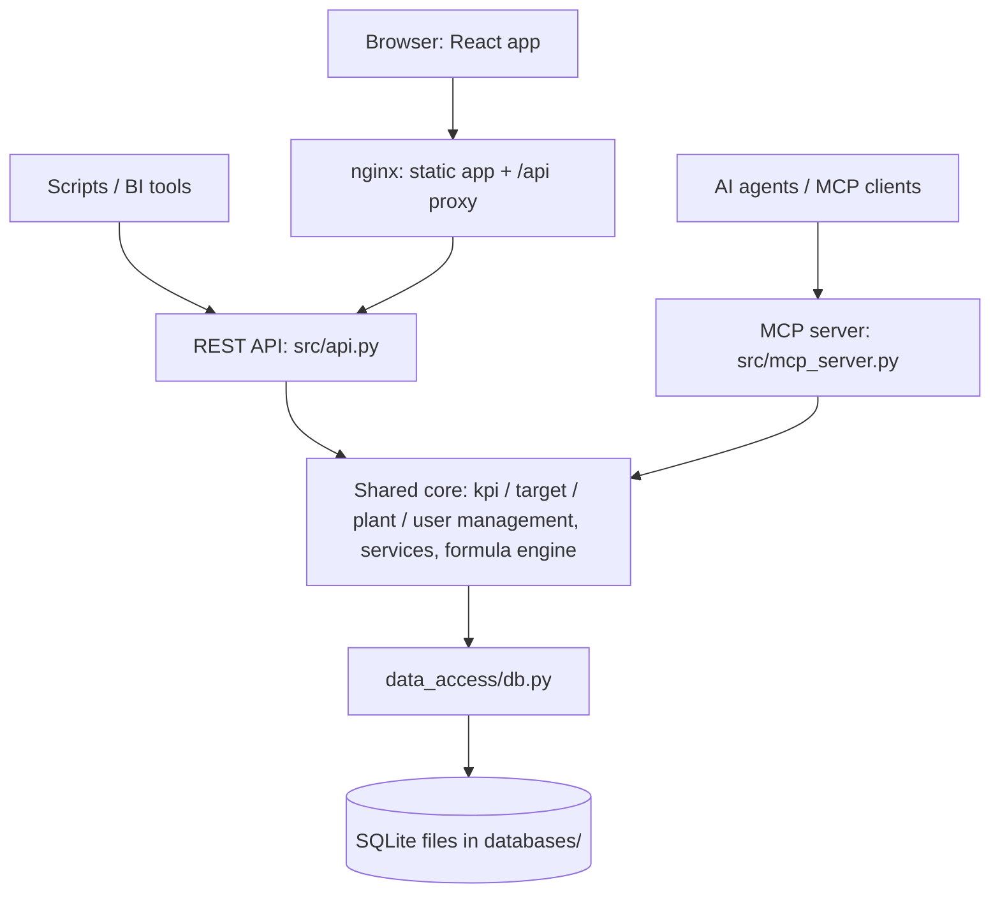

# Architecture

One Python core, holding the data access, the business rules and the math, is exposed through two server processes: the **REST API** (behind the React app) and the **MCP server** (for AI agents). Both read and write the same SQLite files and enforce the same rules.

## Components

### Front ends
- **`frontend/`**: React 19, TypeScript and Vite, with TanStack Query and Recharts.
  - Tab-based (no router); one workspace component per tab.
  - It calls the API same-origin under `/api`. The Vite dev server proxies that path in development, and nginx proxies it in the container.
  - Sessions are kept in `localStorage`. A 401 signs you out; network errors show a retry screen instead.
  - See [`frontend/README.md`](../frontend/README.md).
- **`src/api.py`**: the FastAPI REST API.
  - A middleware rejects any request without a valid session, except an allow-list of public routes. Route handlers only shape requests and responses; the logic lives in the core.
  - Admin and self-service rules come from `user_management/access.py`.
  - Domain errors (`FormulaError`, `TargetValidationError`, `RestoreError`) become 400s, and `AccessDenied` becomes 403.
- **`src/mcp_server.py`**: the MCP server, built on the official `mcp` SDK (`MCPServer`). It has 60 tools over stdio or Streamable HTTP; HTTP is authenticated with per-user API keys.
  - It uses the same core functions and the same `access.py` rules as the REST API.
  - A parity test keeps it in step with the REST routes. See [mcp.md](mcp.md).

### Core (`src/`)
| Module | Responsibility |
|---|---|
| `target_management/annual.py` | The save pipeline. In one transaction: write the entered values and audit rows, recompute dependent formula KPIs in dependency order, and repartition every affected KPI. It also recalculates after split, formula or aggregation-type changes. |
| `target_management/repartition.py` | Annual target → daily series (period weights × day shape, events, scale reconciliation) → week, month and quarter aggregates. See [features.md](features.md). |
| `core/formula.py` | Safe formula evaluation. Parses with `ast` and walks a whitelist; never calls `eval`. Includes cycle detection helpers. |
| `core/node_engine.py` | Evaluates the visual formula DAG (`formula_json`) |
| `kpi_management/` | Folders and KPIs (`crud.py`), split templates (`splits.py`), KPI definition templates (`templates.py`), per-plant visibility (`visibility.py`) |
| `plants_management/` | Facilities. Force-delete also removes the facility's data in the other databases. |
| `user_management/` | Accounts, sessions and API keys (`crud.py`), plus who may manage what (`access.py`) |
| `services/` | `actuals_service` (measurements, performance status, trend), `history_service` (audit trail), `split_analyzer` (ML seasonality predictor) |
| `data_retriever.py` | Read queries for the UI and API (joins across files, chronological period ordering) |
| `export_manager.py` / `import_manager.py` | Human-readable CSV exports; the raw backup ZIP and its validated, transactional restore |
| `config/` | Constants (calculation types, profiles, logics) and settings (`KPI_DB_DIR`, `KPI_EXPORT_DIR`, upload cap) |

### Data access
- **`data_access/db.py`** is the only way code opens SQLite. `connect()` does the following:
  - sets a busy timeout, because the REST API and the MCP server share the files;
  - enables foreign keys and returns `sqlite3.Row` rows;
  - commits on success and rolls back on error;
  - always closes the connection.

  Writes that span several files (a save touches targets, the four period files and history) go through **one connection with the other files ATTACHed**, so SQLite commits them atomically. Rollback-journal mode is used, because WAL isn't atomic across attached databases.
- **`data_access/setup.py`** creates and migrates every database on startup; both servers call it. It is idempotent.
  - It adds missing columns.
  - Where `ALTER TABLE` isn't enough, it rebuilds tables with SQLite's recommended procedure: dropping old CHECK constraints, dangling or cross-file foreign keys, and untyped period columns.
  - It seeds the preset split templates once.

The files and tables are listed in [database_schema.md](database_schema.md).

## Data flow: saving a target

1. **Input.** Target Entry, `POST /targets/annual` or an MCP tool sends the values for one or more KPIs and one or more plants.
2. **Validation.** Values for calculated KPIs are rejected; blank values are left unchanged.
3. **Write.** In one transaction across the targets, period and history databases:
   1. The annual values are upserted, and an audit row is written for each value that actually changed.
   2. Every formula KPI that depends, directly or transitively, on a changed KPI is recomputed in topological order. Target *N* of a formula KPI is computed from target *N* of its inputs.
   3. Each affected KPI is repartitioned into daily values, using its split template if one covers the year, otherwise an even split. The daily values are then aggregated into weeks, months and quarters.
4. **Read.** The app, the API or an agent reads the periodic targets back from the per-period tables.

Changing a split template, a formula or a KPI's aggregation type runs steps 3.2–3.3 for the affected KPIs.

## Deployment

`compose.yml` runs three containers that share the `kpi_databases` volume:

| Service | Image | Notes |
|---|---|---|
| `backend` | `Dockerfile` (Python 3.12-slim, non-root uid 1000) | `uvicorn src.api:app` on :8000, published on loopback. It trusts `X-Forwarded-For` from the proxy, so the login rate limiter sees real client addresses. |
| `frontend` | `frontend/Dockerfile` (Node 22 build → nginx) | Serves the app on :80 (host `FRONTEND_PORT`, default 3000) and proxies `/api/` to `backend:8000` with a 25 MB body limit and a 300 s timeout. Sends a CSP and other security headers. |
| `mcp_server` | same image as the backend | `python -m src.mcp_server --http` on :8001, published on loopback. It starts once the backend is healthy, which ensures the backend runs the migrations first. |

All three have healthchecks and `restart: unless-stopped`. The backend image contains only `requirements.txt` and `src/`. Settings are listed in the README's configuration table and in `.env.example`.

## Technology

- **Backend:** Python 3.12+, FastAPI, uvicorn, the `mcp` SDK, numpy and pandas (repartition), scikit-learn (seasonality predictor), and SQLite (standard library).
- **Frontend:** React 19, TypeScript (strict), Vite, TanStack Query, Recharts, and lucide-react icons. Linted with oxlint (including react-hooks rules) and tested with vitest.
- **Tooling:** pytest; Playwright for the doc screenshots; Podman or Docker Compose.
