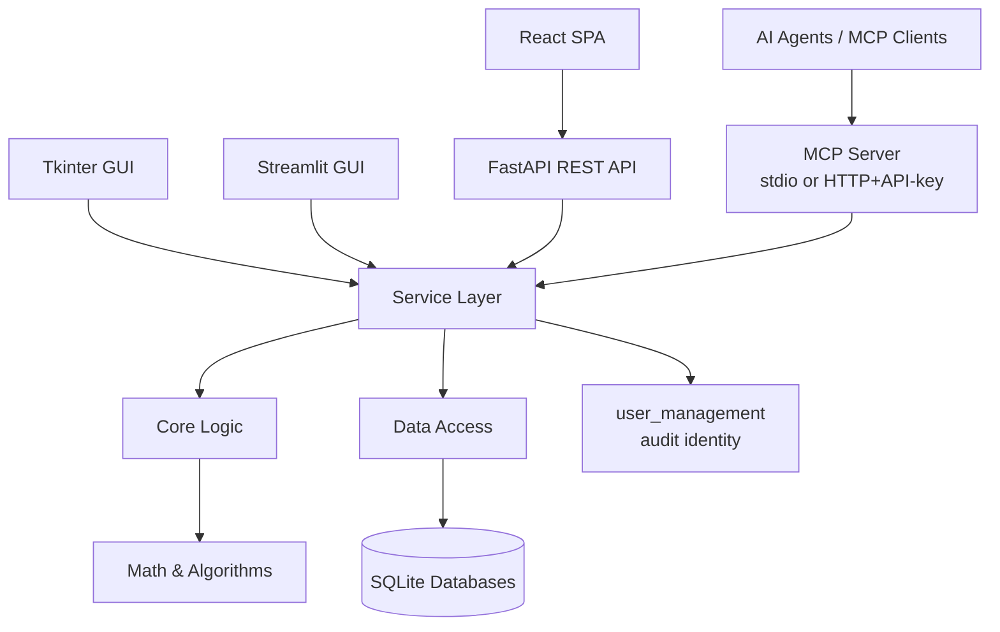

# System Architecture

The Data Entry KPI system follows a modular, layered architecture: one shared Python core (data access, business logic, math) is exposed through **four** independent front-ends — a React SPA, a REST API, an MCP server, and the original Tkinter/Streamlit GUIs — all reading and writing the same SQLite databases.

## 🏗️ High-Level Structure

## 📂 Module Breakdown

### 1. Interfaces
Four presentation layers sit on top of the same service layer:
- **`src/api.py`**: FastAPI REST API. The backend for the React app, but usable directly (Swagger UI at `/docs`). Thin route handlers that call straight into the service/CRUD modules below — no business logic lives here beyond request/response shaping. A login-session gate (`@app.middleware("http")`) rejects every request without a valid `Authorization: Bearer <token>` except `/auth/*`, `/health`, and the docs routes — see [api_reference.md](api_reference.md#auth). Handlers that log `changed_by` pull it from the authenticated session (`Depends(get_current_user)`), never from the request body.
- **`src/mcp_server.py`**: Exposes a fixed tool registry (`get_kpi_tree`, `create_kpi_indicator`, `update_target_value`, `get_performance_status`, `soft_delete_kpi`, ...) over JSON-RPC. Two transports share the same `dispatch_tool_call`/`handle_json_rpc_request` functions: **stdio** (one JSON-RPC request per line — how local clients like Claude Desktop spawn it as a subprocess) and **HTTP** (`--http` flag, a small FastAPI app on `POST /mcp`, gated by an `Authorization: Bearer <api_key>` header resolved via `user_management.crud.validate_api_key`). On the HTTP transport, the resolved user's name is force-injected as `changed_by` on every tool call — the caller cannot self-report a different identity.
- **`frontend/`**: React + TypeScript + Vite SPA. Tab-based navigation (no router) over `src/api.py`; see [`frontend/README.md`](../frontend/README.md) for its internal structure.
- **`tkinter_app/`**: A stateful desktop application using `ttk.Notebook` for tabbed navigation. It directly instantiates persistent controller classes for each tab.
- **`streamlit_app/`**: A stateless web application. It uses a component-based structure where each "page" is a function re-executed on interaction. It relies on `st.session_state` for persistence.

### 2. Services (`src/services/`, `src/kpi_management/`, `src/target_management/`, `src/user_management/`)
This layer orchestrates business operations:
- **`target_management.annual`**: The brain of the system. It handles the "Save" operation and triggers the repartition engine.
- **`target_management.repartition`**: Responsible for the mathematical breakdown of annual targets into daily/weekly/monthly values.
- **`kpi_management.*`**: Modules for CRUD operations on the KPI hierarchy (Groups, Subgroups, Indicators, Templates, Global Splits, Plant Visibility).
- **`plants_management.*`**: Facility CRUD.
- **`user_management.crud`**: User accounts (`users`, PBKDF2-hashed passwords), login sessions (`sessions`), and MCP API keys (`api_keys`) — three separate credential types, all hashed at rest, none of them interchangeable. Accounts + sessions are real access control for the React app and REST API (see `_require_session` middleware above); API keys are access control specifically for the MCP HTTP transport.
- **`services.split_analyzer`**: A specialized service for Multivariate Regression analysis (OLS/Ridge/Random Forest race with cross-validation), used to predict seasonality weights from an uploaded dataset.
- **`services.history_service`**: Writes/reads the audit tables (`kpi_definition_history`, `target_value_history`) — every KPI spec edit and every target value change that actually changes a value is logged here with `changed_by` and a timestamp.
- **`export_manager` / `import_manager`**: Two independent CSV shapes for two independent purposes — `export_manager.export_all_data_to_global_csvs` / `export_single_table` produce human-readable, joined CSVs (plant/indicator names inlined) for BI consumption, which are **not** restorable. `export_manager.export_raw_backup_csvs` / `import_manager.import_from_zip` instead dump/restore each table's literal columns (including primary keys and FK columns, in dependency order), which is what the ZIP backup/restore flow uses — this is the only pairing that round-trips correctly.

### 3. Data Access (`src/data_retriever.py`, `src/data_access/`)
- **`data_retriever.py`**: A facade for **Read** operations. It provides optimized queries for UI consumption (e.g., fetching full hierarchies, joining plant names).
- **`data_access/setup.py`**: `setup_databases()` creates/migrates every SQLite file. It's additive and idempotent (`CREATE TABLE IF NOT EXISTS` + `PRAGMA table_info` column-existence checks before `ALTER TABLE`), safe to call on every startup — `src/api.py` does so in a FastAPI `startup` event, and both legacy GUIs call it too.

## 🔄 Data Flow: Target Calculation

1.  **User Input**: User saves an annual target (React app, REST API, MCP tool call, or a legacy GUI).
2.  **Orchestration (`target_management.annual.save_annual_targets`)**:
    -   Saves the raw annual value(s) — one call handles 1..N target scenarios and, when `plant_id` is a list, broadcasts to every plant in it.
    -   Diffs old vs. new value and logs to `history_service.record_target_change` when it actually changed.
    -   Resolves formula-based (calculated) KPIs' annual values iteratively (a KPI's formula can reference other KPIs' target values).
    -   Rescans *every* calculated KPI system-wide (not just the one just saved) so that a change to a driver KPI ripples into anything that depends on it.
3.  **Repartition (`target_management.repartition.calculate_and_save_all_repartitions`)**:
    -   Runs once per affected KPI, in **topological (dependency) order** — a calculated KPI's own repartition reads its drivers' already-repartitioned daily values straight out of `daily_targets`, so drivers must be repartitioned first; a DFS-based topological sort over the formula dependency graph guarantees this.
    -   **Rule-based**: uses the KPI's own `repartition_logic`/`distribution_profile`, or — if a Global Split is linked — the split's logic/profile/weights instead (the split fully overrides the KPI's own settings, it does not merge with them).
    -   **Reconciliation**: adjusts daily values so their sum/mean exactly matches the annual target after profile shaping and any event adjustments.
4.  **Persistence**: Aggregated results (Daily, Weekly, Monthly, Quarterly) are stored in dedicated per-period SQLite tables for fast retrieval by any interface.

## 🐳 Deployment

`compose.yml` defines three containers, all sharing one named volume (`kpi_databases`) for `databases/`:
- **`backend`** — `Dockerfile` (root), runs `uvicorn src.api:app` on `:8000`.
- **`frontend`** — `frontend/Dockerfile`, a two-stage Node build served by nginx on `:80` (mapped to host `:3000`); `VITE_API_URL` is a build-time arg baked into the JS bundle.
- **`mcp_server`** — same root `Dockerfile`, but runs `python src/mcp_server.py --http` on `:8001`. It must run in HTTP mode in a container: the stdio transport expects a piped stdin from a local process launcher, which a detached container doesn't have.

## 🛠️ Key Technologies

-   **Backend**: Python 3.11+ (the `numpy>=2.3.2` pin in `requirements.txt` requires it; the container image uses `python:3.12-slim`), FastAPI, uvicorn.
-   **Frontend**: React 19, TypeScript, Vite, TanStack Query, Recharts.
-   **Database**: SQLite (split into multiple files: `db_kpis.db`, `db_kpi_targets.db`, `db_kpi_days.db`, `db_users.db`, etc. to manage file size and locking).
-   **Math / ML**: `numpy`/`pandas` for vectorized distribution calculations, `scikit-learn` for the seasonality predictor (OLS/Ridge/RandomForest).
-   **Plotting**: `matplotlib` (Tkinter), `plotly` (Streamlit), `recharts` (React).
