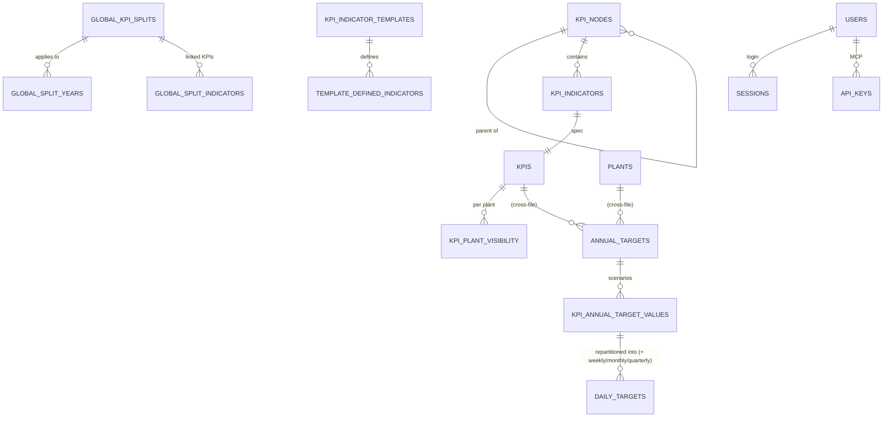

# Database schema

Data is split across several SQLite files in `databases/` (or `$KPI_DB_DIR`). `src/data_access/setup.py` creates and migrates them on every start of the REST API or the MCP server, and is idempotent. Writes that span files use one connection with the other files ATTACHed, so they commit atomically (see [architecture.md](architecture.md#data-access)).

SQLite foreign keys can't cross files. Columns like `plant_id` (pointing into `db_plants.db`) are therefore plain integers, and the code keeps them consistent: deleting a plant with `force` removes its rows everywhere, and deleting a split recalculates the KPIs that used it.

## Files

| File | Tables |
|---|---|
| `db_kpis.db` | `kpi_nodes`, `kpi_indicators`, `kpis`, `units_of_measure`, `kpi_plant_visibility` |
| `db_plants.db` | `plants` |
| `db_kpi_targets.db` | `annual_targets`, `kpi_annual_target_values`, `kpi_targets` (deprecated) |
| `db_kpi_days.db` / `_weeks` / `_months` / `_quarters` | `daily_targets` / `weekly_targets` / `monthly_targets` / `quarterly_targets` |
| `db_kpi_templates.db` | `global_kpi_splits`, `global_split_years`, `global_split_indicators`, `kpi_indicator_templates`, `template_defined_indicators`, `app_meta` |
| `db_kpi_actuals.db` | `actual_measurements` |
| `db_kpi_history.db` | `kpi_definition_history`, `target_value_history` |
| `db_users.db` | `users`, `sessions`, `api_keys` |

## KPI structure (`db_kpis.db`)

### `kpi_nodes`
The folder hierarchy. Columns: `id`, `name`, `parent_id` (self-reference, NULL at the top level), `node_type` (`folder`; `group` and `subgroup` are legacy), `custom_level_label`, `is_active`, and `indicator_template_id` (the KPI definition template the folder is linked to, if any). `UNIQUE(name, parent_id)`; the code also prevents duplicate top-level names.

### `kpi_indicators`
The named entry in a folder: `id`, `name`, `node_id`, `is_active`. Soft-deleting a KPI sets `is_active = 0`; deleted KPIs disappear from every list, export and recalculation. `UNIQUE(name, node_id)`; a deleted KPI's name is freed by renaming it.

### `kpis`
The KPI definition (spec), 1:1 with `kpi_indicators`. **`kpis.id` is the "kpi_id" used everywhere else.**

| Column | Meaning |
|---|---|
| `indicator_id` | The indicator (unique) |
| `calculation_type` | `Sum`, `Average`, `Last`, `Min`, `Max` or `Count` (legacy `Incremental` is read as `Sum`) |
| `unit_of_measure`, `description`, `owner`, `visible` | Descriptive fields |
| `direction` | `Higher is Better`, `Lower is Better` or `Range` |
| `threshold_json` | `{"warning_margin": 0.05, "error_margin": 0.15, "min_target": …, "max_target": …}` |
| `formula_string` | e.g. `[1] / [2]`. Makes the KPI calculated. |
| `formula_json` | A visual formula DAG (alternative to `formula_string`) |
| `is_calculated` | Derived: set when there is a formula |
| `default_distribution_profile` | Day shape used when no split template applies |
| `target_count` | Number of target scenarios (1–10) |
| `target_labels` | `{"1": "Budget", "2": "Stretch"}`. Names shown instead of "Target 1 (Base)". |
| `target_granularity` | Informational only |
| `time_filter_type`, `time_filter_value` | `None`, or `Rolling` with a number of days, for the performance status |

### `units_of_measure`
The units registry (`name` is unique).

### `kpi_plant_visibility`
`(kpi_id, plant_id) → is_enabled`. A missing row means the KPI is enabled for that plant.

## Facilities (`db_plants.db`)

`plants`: `id`, `name` (unique), `description`, `visible` (whether "apply to all facilities" saves include it), `color` (`#rrggbb`, used in charts), `is_active`.

## Targets (`db_kpi_targets.db`)

### `annual_targets`
One row per `(year, plant_id, kpi_id)`. The repartition columns (`repartition_logic`, `repartition_values`, `distribution_profile`, `profile_params`, `global_split_id`) only matter for records written by older API clients. Today a KPI's split template, assigned in KPI Explorer, takes precedence; see [features.md](features.md#2-repartition-annual--day-week-month-quarter).

### `kpi_annual_target_values`
One row per target scenario: `annual_target_id`, `target_number` (1..N), `target_value`, `is_manual`, and `is_formula_based` (1 when the value was computed from a formula). `formula` and `formula_inputs` are legacy and no longer written. `UNIQUE(annual_target_id, target_number)`.

### `kpi_targets` (deprecated)
A flat table of explicit `period_start`/`period_end` targets, exposed only by the deprecated `GET`/`POST /targets`. Repartition doesn't read it.

## Periodic targets (`db_kpi_days|weeks|months|quarters.db`)

Each table has the same columns: `year`, `plant_id`, `kpi_id`, `target_number` (> 0), a period column and `target_value`. The unique key is `(year, plant_id, kpi_id, target_number, period)`.

| Table | Period column | Values |
|---|---|---|
| `daily_targets` | `date_value` | `2026-03-14` |
| `weekly_targets` | `week_value` | `2026-W11` (ISO year and week) |
| `monthly_targets` | `month_value` | `March` |
| `quarterly_targets` | `quarter_value` | `Q1` |

These rows are always derived: they're rewritten whenever the annual value, the split template, the formula or the aggregation type changes. Reads return them in chronological order.

## Split and KPI templates (`db_kpi_templates.db`)

| Table | Purpose |
|---|---|
| `global_kpi_splits` | A split template: `name` (unique), `repartition_logic` (`Year`, `Month`, `Quarter` or `Week`), `repartition_values` (JSON weights in percent), `distribution_profile`, `profile_params` (JSON: sine amplitude and phase, weekday weights, `events`, ML provenance). `year` is legacy. |
| `global_split_years` | `(global_split_id, year)`. The years a template applies to; none means every year. |
| `global_split_indicators` | `(global_split_id, indicator_id)` links, with an optional `override_distribution_profile`. A KPI uses the linked template that covers the year. |
| `kpi_indicator_templates` | Reusable sets of KPI definitions: `name` (unique), `description` |
| `template_defined_indicators` | Each definition: `indicator_name_in_template`, `default_calculation_type`, `default_unit_of_measure`, `default_visible`, `default_description` |
| `app_meta` | Internal flags, e.g. "presets seeded" |

## Actuals (`db_kpi_actuals.db`)

`actual_measurements`: `kpi_id`, `plant_id`, `measurement_date` (`YYYY-MM-DD`), `actual_value`. One row per KPI, plant and day; recording again overwrites it.

## Audit trail (`db_kpi_history.db`)

| Table | Columns |
|---|---|
| `kpi_definition_history` | `kpi_id`, `changed_at`, `changed_by`, `change_type` (`CREATE`, `UPDATE`, `SOFT_DELETE` or `HARD_DELETE`), `old_value_json`, `new_value_json` (full spec snapshots). Re-saving identical values isn't recorded. |
| `target_value_history` | `kpi_id`, `plant_id`, `target_number`, `period_start`, `period_end` (the year's bounds), `old_value`, `new_value`, `changed_at`, `changed_by`. Only values that actually changed are recorded. |

`changed_by` is the name of the logged-in user or API-key owner, or `$MCP_STDIO_USER` over stdio. It is never taken from request data.

## Accounts (`db_users.db`)

| Table | Columns |
|---|---|
| `users` | `name` (unique), `email`, `color`, `password_hash` and `password_salt` (PBKDF2-HMAC-SHA256, 260k iterations), `is_active`, `is_admin`, `created_at` |
| `sessions` | `user_id`, `token_hash` (SHA-256; the raw token is never stored), `created_at`, `expires_at` (30 days), `is_active` |
| `api_keys` | `user_id`, `label`, `key_prefix` (shown in lists), `key_hash` (SHA-256), `created_at`, `last_used_at`, `is_active` |

Sessions authenticate the web app and REST API; API keys authenticate the MCP HTTP transport. Neither works in place of the other. Accounts are not part of backups.

## Relationships

