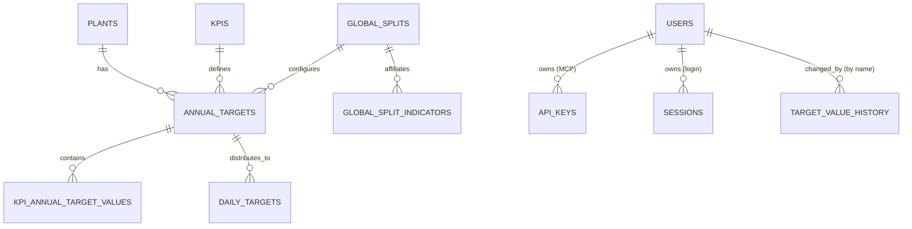

# Database Schema Documentation

The system utilizes a distributed SQLite architecture. Data is partitioned across multiple database files to optimize performance and manage logical separation.

## 🗄️ Database Files (`databases/`)

- **`db_kpis.db`**: Stores the structural definitions (Hierarchy, Specs, Links, per-plant visibility overrides).
- **`db_plants.db`**: Stores facility data.
- **`db_kpi_targets.db`**: Stores annual target values and formula configurations (see the note on two target systems below).
- **`db_kpi_templates.db`**: Stores reusable KPI templates **and** Global Split templates.
- **`db_kpi_days.db`, `_weeks.db`, `_months.db`, `_quarters.db`**: Store distributed periodic values, one table per granularity.
- **`db_kpi_actuals.db`**: Actual (measured, not target) values per KPI/plant/date.
- **`db_kpi_history.db`**: Audit trail — every KPI definition edit and target value change.
- **`db_users.db`**: User accounts (password-based login, required to use the app/API), login sessions, and MCP API keys.

## 📋 Schema Details

### 1. Structure (`db_kpis.db`)

#### `kpi_nodes`
Recursive hierarchy (Group > Subgroup > Folder, self-referencing `parent_id`).

#### `kpi_indicators`
The named leaf of the hierarchy (`node_id` FK). `kpis` below is its 1:1 spec.

#### `kpis`
The central definition table for metrics.
- `id` (PK): Unique KPI Specification ID.
- `indicator_id` (FK, UNIQUE): 1:1 link to `kpi_indicators`.
- `calculation_type`: Aggregation used when rolling up periods (`Sum`/`Incremental`, `Average`, `Last`, `Min`, `Max`, `Count` — free text, not DB-enforced).
- `unit_of_measure`, `visible`, `owner`, `direction` (`Higher is Better` / `Lower is Better` / `Range`).
- `formula_json` / `formula_string`, `is_calculated`: formula-based (calculated) KPI support.
- `default_distribution_profile`, `target_granularity` (`Daily`/`Weekly`/`Monthly`/`Quarterly`/`Yearly`).
- `target_count`: **how many target scenarios this KPI has** (1..N — drives how many input rows the Target Entry UI renders; not fixed at 2).
- `target_labels`: JSON string mapping `target_number` to a display name, e.g. `{"1": "Budget", "2": "Committed"}`. Optional per-target-number override editable in the KPI Explorer; a missing/blank entry falls back to the built-in "Target 1 (Base)" / "Target 2 (Stretch)" / "Target N" defaults (`frontend/src/types/index.ts:targetLabel`).
- `threshold_json`: `{"warning_margin": 0.05, "error_margin": 0.15, "min_target": ..., "max_target": ...}` — used by `actuals_service.evaluate_performance_status`.
- `time_filter_type` (`None`/`rolling`), `time_filter_value`: rolling-window day count for actuals filtering.

#### `kpi_plant_visibility`
`(kpi_id, plant_id) -> is_enabled`. Missing row means "visible" (default-on).

### 2. Targets (`db_kpi_targets.db`) — two parallel systems, know which one you're touching

- **`annual_targets` + `kpi_annual_target_values`** is the **primary system**. This is what the React Target Entry workspace, the Tkinter/Streamlit GUIs, and the repartition engine all read/write, via `target_management.annual.save_annual_targets` and `POST /targets/annual`.
- **`kpi_targets`** is a separate, simpler flat table (explicit `period_start`/`period_end` boundaries, no repartition). It's exposed via `POST /targets` / `GET /targets` and the `update_target_value` MCP tool, but **the repartition engine does not read it** — writing to it does not trigger any daily/weekly/monthly distribution.

#### `annual_targets`
- `year`, `plant_id`, `kpi_id`: Composite unique key.
- `repartition_logic`: `Year` / `Month` / `Quarter` / `Week`.
- `distribution_profile`: `even_distribution` / `annual_progressive` / `annual_progressive_weekday_bias` / `true_annual_sinusoidal` / `event_based_spikes_or_dips`.
- `repartition_values`: JSON string storing custom weights (e.g., `{"January": 10.5, "February": 12...}`).
- `global_split_id`: (FK, Nullable) Link to a Global Split template. If set, **overrides** (does not merge with) this row's own `repartition_logic`/`distribution_profile`/`repartition_values`.

#### `kpi_annual_target_values`
Normalized storage for dynamic targets (however many `kpis.target_count` says this KPI has).
- `annual_target_id` (FK): Link to parent `annual_targets` record.
- `target_number`: Integer (1, 2, 3...).
- `target_value`: The calculated or entered value.
- `is_manual`, `is_formula_based`, `formula`, `formula_inputs`: manual-entry vs. formula-derived per target scenario.

### 3. Periodic Data (`db_kpi_*.db`)

#### `daily_targets` (in `db_kpi_days.db`)
- `date_value`: ISO Date string (YYYY-MM-DD).
- `target_value`: The precise value for that specific day.
- `kpi_id`, `plant_id`, `target_number`.

*Note: Weekly, Monthly, and Quarterly tables follow the same structure with their respective period keys.*

### 4. Splits & Templates (`db_kpi_templates.db`)

- **`global_kpi_splits`** — a reusable named seasonal curve (`repartition_logic`, `distribution_profile`, `repartition_values`, `profile_params`). `profile_params` can carry ML provenance (`{"source": "multivariate_ml", "winning_model": ..., "r_squared": ...}`) when published from the seasonality predictor.
- **`global_split_years`** — `(global_split_id, year)`, a split can apply to multiple years.
- **`global_split_indicators`** — which indicators a split is affiliated with, plus an optional `override_distribution_profile` per indicator.
- **`kpi_indicator_templates`** / **`template_defined_indicators`** — KPI *definition* templates (distinct from Global Splits), for stamping out the same indicator set across multiple hierarchy nodes.

### 5. Audit & Users

#### `db_kpi_history.db`
- **`kpi_definition_history`**: `kpi_id, changed_at, changed_by, change_type, old_value_json, new_value_json` — one row per spec edit (create/update/soft-delete).
- **`target_value_history`**: `kpi_id, plant_id, target_number, period_start, period_end, old_value, new_value, changed_at, changed_by` — one row per annual target value that actually changed (no-op saves aren't logged).

#### `db_users.db`
- **`users`**: `id, name (unique), email, color, password_hash, password_salt, is_active, created_at`. `password_hash`/`password_salt` are PBKDF2-HMAC-SHA256 (260,000 iterations) — required to log in; a row with `password_hash IS NULL` (only possible on a database that pre-dates the login feature) can no longer authenticate.
- **`sessions`**: `id, user_id (FK), token_hash (unique), created_at, expires_at, is_active`. One row per login; the raw token is returned once by `/auth/login`/`/auth/register` and never stored — only its SHA-256 hash. 30-day expiry. This is what gates the React app and the REST API.
- **`api_keys`**: `id, user_id (FK), label, key_prefix, key_hash (unique), created_at, last_used_at, is_active`. Only a SHA-256 hash and an 8-char prefix are stored; the raw key is shown once at creation and cannot be retrieved again. Used to authenticate the MCP HTTP transport — a **separate credential from login**, not interchangeable with a session token.

## 🔄 Relationships

