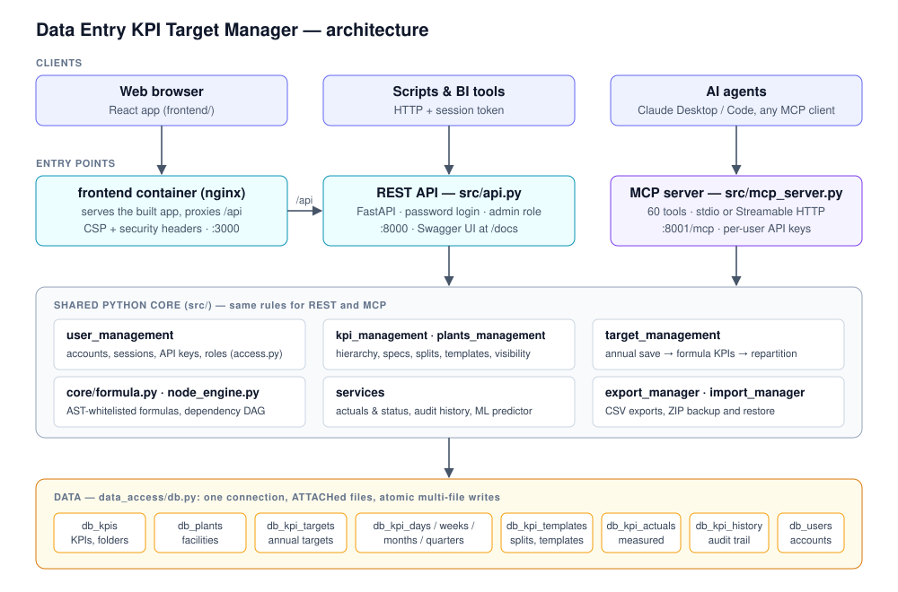

# Documentation

The Data Entry KPI Target Manager turns annual KPI targets into daily, weekly, monthly and quarterly targets per facility. One Python core is exposed through a **React web app** (backed by a **REST API**) and an **MCP server** for AI agents; all three share the same data and rules.



## Guides
- **[User guide](user_guide.md)**: every screen of the web app, with screenshots.
- **[MCP server](mcp.md)**: connecting Claude Desktop, Claude Code or any MCP client; transports, API keys, roles, and all 60 tools.
- **[REST API reference](api_reference.md)**: routes, authentication, roles and errors.

## How it works
- **[Architecture](architecture.md)**: components, the save pipeline, deployment.
- **[Core logic](features.md)**: aggregation types, repartition, split templates, formulas, the ML seasonality predictor, performance status, audit and backup.
- **[Code-level deep dive](code_depth.md)**: the engine internals, with file and function references.
- **[Database schema](database_schema.md)**: the SQLite files and tables.

## Quick start

```bash
python scripts/dev_backend.py
```
```bash
npm --prefix frontend run dev
```
Then open http://localhost:5173 and create the first account; it becomes the admin. Optionally run `python scripts/seed_demo.py` for demo data.

```bash
podman compose up --build -d
```
This starts the containers: the app on :3000, the API on 127.0.0.1:8000, MCP on 127.0.0.1:8001/mcp.

The [repository README](../README.md) has the full setup, configuration and MCP client snippets.

## Project history
- [CHANGELOG](../CHANGELOG.md)
- [Audit report](../AUDIT.md): the findings of the October 2026 review and how each was resolved.
- `archive/`: older planning documents and per-task changelogs, kept for reference.
