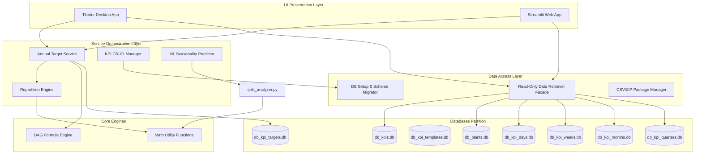
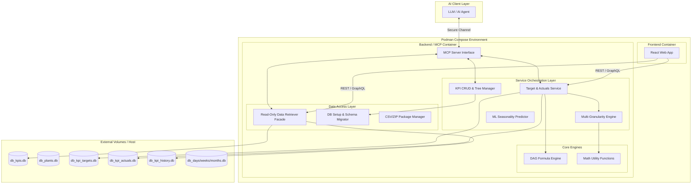

## Data Entry KPI Target Manager — Complete Technical & Product Specification

This document serves as the absolute source of truth for the **Data Entry KPI Target Manager**. It outlines the business requirements, architectural design, database layout, core backend algorithms (including the DAG formula engine and ML predictors), and provides detailed operational guides for both the Tkinter and Streamlit frontends.

---

### 1. Executive Summary & Product Requirements

The **Data Entry KPI Target Manager** is an enterprise-grade platform designed to manage and distribute KPI targets across multiple manufacturing plants. In large organizations, setting annual targets (e.g., "Reduce carbon emissions by **10%**") is straightforward, but breaking them down into daily, weekly, or monthly objectives across various facilities is mathematically complex and error-prone.

This platform solves this challenge by offering:

* **Hierarchical Management:** Organizing metrics into deep, nested trees (Groups > Subgroups > Folders > Indicators).
* **Rule-Based and ML-Driven Allocation:** Disaggregating annual targets using predefined curves (sinusoidal, progressive) or advanced multivariate regression models that discover seasonality trends using external drivers (such as temperature, production rates, or sales volume).
* **Formula Dependency Graphs:** Allowing KPIs to be calculated on the fly from other KPIs using a Directed Acyclic Graph (DAG) formula system (e.g., `KPI_3 = KPI_1 / KPI_2`).
* **Dual Frontend Interfaces:** Supporting native desktop operations via Tkinter (for rapid bulk entry and offline speed) and a web interface via Streamlit (for remote access and dashboard viewing).

---

### 2. High-Level Architecture

The system utilizes a modular, layered architecture that strictly separates UI state management from business rules and databases. This ensures total calculation parity across both Tkinter and Streamlit.



#### Module Responsibilities:

1. **`src/interfaces/`**: Hosts the frontends. Tkinter uses object-oriented stateful frames and event-based callbacks. Streamlit relies on stateless re-execution scripts utilizing `st.session_state` to store user focus.
2. **`src/core/node_engine.py`**: Compiles formulas into memory structures, checks for circular dependencies, and evaluates mathematical expressions.
3. **`src/target_management/repartition.py`**: Executes the mathematical disaggregation of targets to the daily level, then rolls them up to weekly, monthly, and quarterly tables.
4. **`src/services/split_analyzer.py`**: Contains regression logic, cross-validation scoring, and Monte Carlo confidence intervals.
5. **`src/data_retriever.py`**: A unified read-only gateway using parameterized queries to merge structural data with targets.

---

### 3. Database Schema & Domain Partitioning

SQLite is used for local storage. Data is partitioned across multiple database files inside the `databases/` folder to prevent locking, control file sizes, and isolate schemas.

#### A. Structure Domain (`databases/db_kpis.db`)

Stores the hierarchical definitions of indicators.

* **`kpi_nodes`**: Self-referencing table storing folders, groups, and subgroups.
* `id` (INTEGER PRIMARY KEY AUTOINCREMENT)
* `name` (TEXT NOT NULL)
* `parent_id` (INTEGER, FOREIGN KEY REFERENCES `kpi_nodes(id) ON DELETE CASCADE`)
* `node_type` (TEXT CHECK(node_type IN ('group', 'subgroup', 'folder')))
* *Constraint*: `UNIQUE(name, parent_id)`


* **`kpi_indicators`**: Leaf nodes linked to specific categories.
* `id` (INTEGER PRIMARY KEY AUTOINCREMENT)
* `name` (TEXT NOT NULL)
* `node_id` (INTEGER NOT NULL, FOREIGN KEY REFERENCES `kpi_nodes(id) ON DELETE CASCADE`)
* `subgroup_id` (INTEGER, Legacy mapping)
* *Constraint*: `UNIQUE(name, node_id)`


* **`kpis`**: Performance specifications for each indicator.
* `id` (INTEGER PRIMARY KEY AUTOINCREMENT)
* `indicator_id` (INTEGER UNIQUE, FOREIGN KEY REFERENCES `kpi_indicators(id) ON DELETE CASCADE`)
* `description` (TEXT)
* `calculation_type` (TEXT NOT NULL CHECK(calculation_type IN ('Incremental', 'Average')))
* `unit_of_measure` (TEXT)
* `visible` (BOOLEAN DEFAULT 1)
* `formula_json` (TEXT, stores JSON representation of calculation DAG)
* `formula_string` (TEXT, stores Python formula string representation)
* `is_calculated` (BOOLEAN DEFAULT 0)
* `default_distribution_profile` (TEXT)


* **`kpi_plant_visibility`**: Toggle mapping per facility.
* `kpi_id` (INTEGER, FOREIGN KEY REFERENCES `kpis(id) ON DELETE CASCADE`)
* `plant_id` (INTEGER, FOREIGN KEY REFERENCES `plants(id) ON DELETE CASCADE`)
* `is_enabled` (BOOLEAN DEFAULT 1)
* *Composite PK*: `(kpi_id, plant_id)`


#### B. Plants Domain (`databases/db_plants.db`)

* **`plants`**: Represents the list of facilities.
* `id` (INTEGER PRIMARY KEY AUTOINCREMENT)
* `name` (TEXT NOT NULL UNIQUE)
* `description` (TEXT)
* `visible` (BOOLEAN DEFAULT 1)
* `color` (TEXT DEFAULT '#000000', used for UI graphing)


#### C. Templates & Splits Domain (`databases/db_kpi_templates.db`)

* **`kpi_indicator_templates`**: Standard KPI package prototypes.
* `id` (INTEGER PRIMARY KEY AUTOINCREMENT)
* `name` (TEXT UNIQUE NOT NULL)
* `description` (TEXT)


* **`template_defined_indicators`**: Default indicators generated when a template is linked to a subgroup.
* `id` (INTEGER PRIMARY KEY AUTOINCREMENT)
* `template_id` (INTEGER NOT NULL, FOREIGN KEY REFERENCES `kpi_indicator_templates(id) ON DELETE CASCADE`)
* `indicator_name_in_template` (TEXT NOT NULL)
* `default_description` (TEXT)
* `default_calculation_type` (TEXT CHECK(default_calculation_type IN ('Incremental', 'Average')))
* `default_unit_of_measure` (TEXT)
* `default_visible` (BOOLEAN DEFAULT 1)


* **`global_kpi_splits`**: Multi-year split weight structures.
* `id` (INTEGER PRIMARY KEY AUTOINCREMENT)
* `name` (TEXT UNIQUE NOT NULL)
* `year` (INTEGER, Legacy compatibility column)
* `repartition_logic` (TEXT DEFAULT 'universal')
* `repartition_values` (TEXT, JSON weights mapping)
* `distribution_profile` (TEXT)
* `profile_params` (TEXT, JSON string)


* **`global_split_years`**: Enables a single split configuration to be active over multiple years.
* `global_split_id` (INTEGER NOT NULL, FOREIGN KEY REFERENCES `global_kpi_splits(id) ON DELETE CASCADE`)
* `year` (INTEGER NOT NULL)
* *Composite PK*: `(global_split_id, year)`


* **`global_split_indicators`**: Links split configurations to indicators.
* `id` (INTEGER PRIMARY KEY AUTOINCREMENT)
* `global_split_id` (INTEGER, FOREIGN KEY REFERENCES `global_kpi_splits(id) ON DELETE CASCADE`)
* `indicator_id` (INTEGER NOT NULL)
* `override_distribution_profile` (TEXT, Nullable override)
* *Constraint*: `UNIQUE(global_split_id, indicator_id)`


#### D. Annual Targets Domain (`databases/db_kpi_targets.db`)

* **`annual_targets`**: Stores plant-specific KPI configuration metadata.
* `id` (INTEGER PRIMARY KEY AUTOINCREMENT)
* `year` (INTEGER NOT NULL)
* `plant_id` (INTEGER NOT NULL)
* `kpi_id` (INTEGER NOT NULL)
* `repartition_logic` (TEXT DEFAULT 'Year')
* `repartition_values` (TEXT DEFAULT '{}')
* `distribution_profile` (TEXT DEFAULT 'annual_progressive')
* `profile_params` (TEXT DEFAULT '{}')
* `global_split_id` (INTEGER, Nullable)
* *Constraint*: `UNIQUE(year, plant_id, kpi_id)`


* **`kpi_annual_target_values`**: Normalized target values storage.
* `id` (INTEGER PRIMARY KEY AUTOINCREMENT)
* `annual_target_id` (INTEGER NOT NULL, FOREIGN KEY REFERENCES `annual_targets(id) ON DELETE CASCADE`)
* `target_number` (INTEGER NOT NULL CHECK(target_number > 0))
* `target_value` (REAL)
* `is_manual` (BOOLEAN DEFAULT 1)
* `is_formula_based` (BOOLEAN DEFAULT 0)
* `formula` (TEXT)
* `formula_inputs` (TEXT DEFAULT '[]')
* *Constraint*: `UNIQUE(annual_target_id, target_number)`


#### E. Distributed Periodic Targets

All distributed target data is split across four databases matching their respective periods. The tables share identical structures:

* **`daily_targets`** (in `db_kpi_days.db`):
* `id` (INTEGER PRIMARY KEY AUTOINCREMENT)
* `year` (INTEGER NOT NULL)
* `plant_id` (INTEGER NOT NULL)
* `kpi_id` (INTEGER NOT NULL)
* `target_number` (INTEGER NOT NULL)
* `date_value` (TEXT NOT NULL) — e.g., `'2026-07-20'`
* `target_value` (REAL NOT NULL)
* *Constraint*: `UNIQUE(year, plant_id, kpi_id, target_number, date_value)`


* **`weekly_targets`** (in `db_kpi_weeks.db`): Uses period column `week_value` (e.g., `'2026-W30'`).
* **`monthly_targets`** (in `db_kpi_months.db`): Uses period column `month_value` (e.g., `'July'`).
* **`quarterly_targets`** (in `db_kpi_quarters.db`): Uses period column `quarter_value` (e.g., `'Q3'`).

---

### 4. Core Backend Logic & Calculation Engines

#### A. The Formula/DAG Engine

Calculated KPIs rely on the DAG engine to compute value flows.

1. **Node Tree Structure**: A graph is instantiated in `KpiDAG` where nodes (`KpiNode`) represent KPI inputs, constant values, or math operations (e.g., `+`, `-`, `*`, `/`, `pow`, `min`, `max`, `avg`, `abs`), connected by edges (`KpiEdge`).
2. **Compilation & Decompilation**:
* `to_formula()` traverses the DAG recursively using memoization to generate a standard algebraic string, mapping inputs using `[KPI_ID]` notation (e.g., `([1] + [2]) / 2.0`).
* `from_formula(formula_str)` compiles standard algebraic strings back to a DAG model. It uses Python's Abstract Syntax Trees (`ast.parse`) to evaluate nodes (`ast.BinOp`, `ast.Call`, `ast.Constant`) and construct the flowchart nodes and edges in a grid alignment layout.


3. **Circular Dependency Guard**:
* `check_for_global_circular_dependencies` runs a depth-first search (DFS) with recursive path backtracking. If any node's dependency path leads back to itself, it returns a trace of the circular path to actively prevent calculation loops.


#### B. Dynamic Repartition Engine

The system disaggregates a single annual target value into daily entries using three primary components:

1. **Weights Calculation (`_get_period_allocations`)**:
* *Incremental (Sum)*: Distributes the annual target proportionally based on percentage weights (e.g., Monthly logic normalized to sum to **100%**).
* *Average (Mean)*: Creates multiplier factors relative to the baseline (1.0).


2. **Profile Curve Calculations (`src/utils/repartition_utils.py`)**:
* **Sinusoidal**: Calculates a modulated phase-offset sine curve based on period indices:

$$\text{proportion}_i=\text{mean\_prop}\times(1+\text{amplitude}\times\sin(\theta_i+\text{phase}))$$


* **Annual Progressive**: Generates a linear gradient profile (e.g., starting at 0.8 and finishing at 1.2).
* **Parabolic**: Computes values following a quadratic curve (e.g., peaking mid-year).


3. **Event Overrides (`_apply_event_adjustments_to_daily_values`)**:
* Applies localized multiplier or offset factors to specific date ranges (e.g., facility closures, maintenance, or winter holidays).


#### C. Target Reconciliation & Precision Adjustments

Once daily values are distributed, floating-point rounding errors and division limits might cause the sum or mean of the daily values to deviate slightly from the original annual target. The reconciliation process automatically adjusts values to maintain exact precision:

* **Incremental KPIs**:
1. Calculates the current sum of the generated daily array.
2. Computes the variance: $\text{diff}=\text{Target}_{\text{Annual}}-\sum(\text{daily\_values})$.
3. Distributes the difference equally: $\text{adjustment}=\text{diff}/N$.
4. Adds the adjustment to each day.


* **Average KPIs**:
1. Calculates the current mean of the daily array.
2. Computes the variance: $\text{diff}=\text{Target}_{\text{Annual}}-\text{mean}(\text{daily\_values})$.
3. Adds the difference directly to all daily values, shifting the dataset's mean to match the target.


#### D. Topological Repartition Propagation

Because calculated KPIs can depend on other targets, updating a parent KPI target requires updating all dependent child target distributions.

1. **Dependency Gathering**: The system parses dependency formulas to build a complete dependency list.
2. **Topological Sorting**: Performs a topological sort of the graph to determine the correct sequential calculation order.
3. **Sequential Calculation**: Evaluates the annual values and runs the daily repartition processes in order. This ensures that when a root-level input changes, its effects cascade accurately downstream through all formula-based KPIs.

---

### 5. The Global Split System & Seasonality Predictor (ML)

#### A. Split Template Model

A global split acts as a template for seasonal weights, defining:

* **Universal Repartition Mode**: A multi-tiered JSON mapping containing preset weights for monthly, weekly, and quarterly levels. When a target references this split ID, it dynamically extracts the appropriate period configuration.
* **Profile Overrides**: Specific indicators linked to a global split can override the global distribution profile (e.g., maintaining sinusoidal allocations while other indicators use linear progressive splits).

#### B. Multivariate Seasonality OLS & Ridge Predictors

To eliminate the guesswork involved in setting periodic weights, the system includes a machine learning engine in `split_analyzer.py` that trains models on historical data and driver variables.

```text
       [ Upload Historical CSV/Excel ]
                      │
           [ Process DateTime Field ]
                      │
     [ Aggregate Features & Target to Index ]
                      │
     [ Normalize Values (0 to 1 scaling) ]
                      │
   ┌──────────────────┴──────────────────┐
   ▼                                     ▼
[ OLS Linear Regression ]       [ L2 Ridge Regression ]
   (Basic trend matching)         (Driver weight decay)
   │                                     │
   └──────────────────┬──────────────────┘
                      ▼
        [ Run Leave-One-Out (LOO) CV ]
                      │
         [ Apply Model Overfit Penalty ]
                      │
         [ Select Winning Model (Max R²) ]
                      │
        [ Generate Target Year Weights ]

```

1. **Data Aggregation**: Aggregates the timeline into period buckets (Month, Quarter, Week, Day).
2. **0-1 Normalization**: Rescales all variables to prevent feature scaling issues:

$$x_{\text{scaled}}=\frac{x-x_{\text{min}}}{x_{\text{max}}-x_{\text{min}}}$$


3. **Model Race**: Runs multiple regression models to find the optimal fit:
* *OLS Regression*: Basic line fitting.
* *Ridge Regression*: L2 penalty weight regularizer (helps when driver variables are correlated).
* *Random Forest Regressor*: Handles non-linear trends (uses complexity penalties on small datasets to avoid overfitting).


4. **Cross-Validation**: Uses Leave-One-Out (LOO) cross-validation for small datasets (<20 records) and K-Fold cross-validation for larger datasets. The model with the highest `$R^2$` score is automatically selected.

#### C. Monte Carlo Volatility Simulation

To calculate uncertainty boundaries for the prediction:

1. Computes the standard deviation ($\sigma$) of the selected model's residuals.
2. Runs **100** iterations, adding random Gaussian noise to the driver inputs (**±5%** volatility) and model predictions.
3. Extracts the 5th and 95th percentiles to define a **90%** Confidence Interval range.

---

### 6. Tkinter Desktop App — Tab-by-Tab Breakdown

The desktop application is optimized for speed and native responsiveness. It utilizes a left sidebar navigation layout that dynamically loads views into the main frame.

```text
+-------------------------------------------------------------------------+
|  KPI Target Manager [Year: 2026] [Plant: Rome Operations]               |
+--------------+----------------------------------------------------------+
|  NAVIGATION  |  Target 1 (Base Plan)           Target 2 (Stretch)       |
|  - Target    |  +---------------------------+  +---------------------+  |
|    Entry     |  | KPI 1: Energy Usage [MWh] |  |                     |  |
|  - KPI       |  | Input: [ 450.00         ] |  | Input: [ 410.00   ] |  |
|    Explorer  |  | History: Y-1: 440 Y-2: 462|  |                     |  |
|  - Templates |  +---------------------------+  +---------------------+  |
|  - Splits    |  | KPI 2: Water Consump. [m3]|  |                     |  |
|  - Analysis  |  | [Formula Calculated     ] |  | [Formula Calculated]|  |
|  - Settings  |  +---------------------------+  +---------------------+  |
|              |  | [ Broadcast value change to all plants: [x] ]      |  |
|              |  +----------------------------------------------------+  |
|              |  | [SAVE ALL DATA]                                    |  |
+--------------+----------------------------------------------------------+

```

#### 1. Target Entry Tab

* **Filters panel**: Provides dropdown selections for the target year and plant. Modifying a filter triggers an immediate database query to reload the tree.
* **KPI tree sidebar**: Displays the structural KPI folders. Selecting a folder filters the visible card panels.
* **Target cards**: Generates distinct cards for each KPI containing:
* *Value inputs*: Edit fields for Target 1 and Target 2.
* *Calculation tags*: Displays blue tags for formula-based KPIs and grey tags for manual entries.
* *Historical references*: Displays labels showing target values from Y-1 and Y-2.
* *Broadcast checkbox*: Select this to save the entered targets across all active facilities simultaneously.


#### 2. KPI Management Tab

An administration panel divided into three sub-tabs:

* **📁 KPI Explorer**:
* *Hierarchy tree*: A `ttk.Treeview` that renders the node nesting structure. Right-clicking a node opens a context menu to add, delete, rename, or move folders.
* *Inspector panel*: Displays properties on the right (Unit, Calc Type, and plant visibility mappings).


* **📋 Templates**:
* Defines reusable KPI indicator profiles. Instantiating a template in a subgroup generates all defined indicators automatically.


* **✂️ Global Splits**:
* Defines universal weight configurations. Selecting a split opens an interactive weights editor panel.


#### 3. Analysis Tab

* **Visual Charting**: Utilizes matplotlib to plot target lines over the established timeline.
* **Tabular Grid**: Renders a scrollable spreadsheet grid showcasing calculated values.
* **Global Health sparklines**: Displays a grid of sparkline charts highlighting historical trends for all active metrics.

#### 4. Data & Settings Tab

* **Database Utilities**: One-click buttons to back up or restore the SQLite databases via ZIP archives.
* **Plant Manager**: Displays the list of plants, allowing color assignments and global visibility toggles.

---

### 7. Streamlit Web App — Page-by-Page Breakdown

The Streamlit app is a web interface tailored for remote access and user-friendly executive visualizations.

#### 1. Operation: Target Entry Page

* **Context selection sidebar**: Sticky dropdowns to select the year and plant, persisting via session state.
* **Metric lookup sidebar**: A comprehensive list of active KPIs. Clicking a KPI button smoothly scrolls it into view.
* **KPI Expander panels**: Expandable configuration cards containing:
* *Inputs*: Values for Target 1 and Target 2.
* *Calculated/Manual toggles*: Toggles to define the underlying calculation logic.
* *Rule settings*: Selectable repartition logic and distribution profiles.


#### 2. KPI Explorer Page

* **Russian-Doll Expanders**: Renders the hierarchical KPI tree using deeply nested expanders.
* **Indicator Property Sheet**: Displays the selected indicator's properties directly in the main area (Unit, Calc Type, Formula JSON, and Plant Visibility checkbox grid).

#### 3. Global Splits & ML Predictor Page

* **Weights preset area**: Edit JSON configurations for custom period distributions.
* **ML Predictor panel**:
* *File Upload*: Drag-and-drop area accepting CSV or Excel files.
* *Dropdown mappings*: Map target histories, relevant dates, and features.
* *Interactive Plotly chart*: Displays historical targets alongside predictions and the **90%** confidence interval.
* *Apply button*: Pushes the predicted weights directly to the split template configuration.


#### 4. Data & Analysis Page

* **Sequential timeline**: Utilizes Plotly to render both historical and future targets. If multiple years are selected, they are displayed sequentially on a single timeline to visualize long-term trends without overlap.
* **Plant comparison**: Plots the same KPI metric across multiple facilities on a single, unified graph.

---

### 8. Data Operations & System Utilities

#### A. CSV Export Layouts

The system generates tightly formatted CSV files to ensure data portability:

1. **Annual Master Targets**:
`Year, Plant_Name, Group_Name, Subgroup_Name, KPI_Name, Target_Name, Target_Value, Unit, Type`
2. **Daily Distributed Details**:
`Date, Year, Plant_ID, KPI_ID, Target_Number, Target_Value`

#### B. Archive Backup Structures

The backup utility packages all database files into a single, timestamped ZIP archive:

```text
kpi_backup_[timestamp].zip
 ├── db_kpis.db
 ├── db_plants.db
 ├── db_kpi_targets.db
 ├── db_kpi_templates.db
 ├── db_kpi_days.db
 ├── db_kpi_weeks.db
 ├── db_kpi_months.db
 └── db_kpi_quarters.db

```

---

### 9. Code Quality & Technical Debt Fixed

During the technical review, several critical bugs were identified and resolved in the codebase:

1. **TypeError in `subgroups.py**`:
* *Issue*: In `_apply_template_indicator_to_new_subgroup`, the code called `add_kpi_indicator(name=..., subgroup_id=...)`. However, the definition in `indicators.py` used the parameter name `node_id`. This mismatch caused a runtime `TypeError` when using keyword arguments.
* *Fix*: Updated the call to use the correct parameter name: `add_kpi_indicator(name=indicator_name, node_id=subgroup_id)`.


2. **NameError in `subgroups.py**`:
* *Issue*: The undefined constant `CALC_TYPE_INCREMENTALE` (with an extra 'E') was referenced in multiple locations, raising runtime `NameError` exceptions.
* *Fix*: Corrected all occurrences to properly use the imported constant `CALC_TYPE_INCREMENTAL`.


3. **Cross-Database Referential Integrity**:
* *Design Note*: Because SQLite does not natively support cross-database foreign keys, the application relies on strict Python code paths (like `delete_kpi_indicator`) to delete target records. Running raw SQL deletes directly on `kpi_nodes` in the database will cause orphaned target data. Deletion operations must always be executed through the application's clean-up functions.


---

### 10. Onboarding Checklist for Developers

To run the codebase locally:

1. **Install dependencies**: Run `pip install -r requirements.txt` (requires Python 3.10+).
2. **Initialize the SQLite databases**: Run `python src/data_access/setup.py` to create the databases in the `databases/` directory and execute necessary migrations.
3. **Run the Tkinter desktop app**: Execute `python main.py tkinter`.
4. **Run the Streamlit web interface**: Execute `python main.py streamlit`.
5. **Verify the OLS predictor**: Run the test suite via `python src/scripts/test_multivariate_analysis.py`.                    # Data Entry KPI Target Manager — Complete Technical & Product Specification

This document serves as the absolute source of truth for the **Data Entry KPI Target Manager**. It outlines the business requirements, architecture design, database layout, core backend algorithms (such as the DAG formula engine and ML predictors), and provides operational guides for the full-stack containerized architecture, including the React UI, Python backend, and the Model Context Protocol (MCP) integration for AI agents.

---

## 1. Executive Summary & Product Requirements

The **Data Entry KPI Target Manager** is an enterprise-grade platform designed to manage, distribute, and track KPI targets and actual performance across multiple manufacturing plants.

This platform solves complex performance management needs by offering:

* **Infinite-Depth Dynamic Hierarchy**: A fully flexible N-depth tree structure. Users can create as many nested organizational levels as needed (e.g., Division > Plant > Department > Line > Machine) utilizing a dynamic Adjacency List model.
* **Dynamic Targets & Granularity**: Targets are no longer strictly annual. Users define the base time granularity (Daily, Weekly, Monthly, Quarterly, Yearly). Data entry supports full-year cyclic completion for sub-yearly targets.
* **Target Immutability & Versioning**: To support multi-year tracking, once a target's time-series data is generated and saved, subsequent changes to the KPI's definition (calculation type, formulas) **will not** retroactively alter historical target values unless explicitly forced by the user.
* **Actuals Tracking & Status Intelligence**: The platform pairs targets with actual time-series fact data. By defining directionality ("Higher is Better", "Lower is Better", or "Range" with thresholds) and applying optional rolling/fixed time filters, the system automatically computes real-time performance status.
* **Advanced Aggregations & Calculated Targets**: Supports Flow vs. Stock metrics with precise roll-up calculations (`Sum`, `Average`, `Last`, `Min`, `Max`, `Count`). For derived metrics (Ratios, Weighted Averages), the calculation type is overridden, and both actuals and target values are dynamically generated by the formula dependency engine.
* **Accountability & Auditability**: Every KPI requires an assigned owner. All structural definitions and target values maintain a strict version history ledger (SCD Type 2) alongside soft-deletion capabilities.
* **Model Context Protocol (MCP) Layer**: A standardized LLM interface allowing AI agents to dynamically interact with the KPI database.
* **100% Containerized Podman Deployment**: The entire application stack is orchestrated within isolated Podman containers.

---

## 2. High-Level Architecture

The system utilizes a modular, layered architecture deployed within a cohesive containerized environment. Strict separation of concerns is maintained between the UI state, business rules, databases, and AI interfaces.



---

## 3. Database Schema & Domain Partitioning

SQLite is used for storage, partitioned across multiple database files.

> **Important Architectural Note on Referential Integrity:** SQLite cannot enforce foreign keys reliably across attached database files. Therefore, cross-database IDs (e.g., `plant_id` or `kpi_id` inside the actuals database) are declared as `NOT NULL` integers, but without `FOREIGN KEY` constraints. Referential integrity is strictly handled at the application layer through **soft deletes** (`is_active` flags) and application-level cascading to prevent orphaned rows.

### A. Dynamic Structure Domain (`databases/db_kpis.db`)

Stores the hierarchical definitions and indicator logic.

* **`kpi_nodes`**: Self-referencing table allowing infinite structural nesting.
* `id` (INTEGER PRIMARY KEY AUTOINCREMENT)
* `name` (TEXT NOT NULL)
* `parent_id` (INTEGER, FOREIGN KEY REFERENCES `kpi_nodes(id) ON DELETE CASCADE`)
* `custom_level_label` (TEXT)
* *Constraint*: `UNIQUE(name, parent_id)`


* **`kpi_indicators`**: Leaf nodes representing the metrics.
* `id` (INTEGER PRIMARY KEY AUTOINCREMENT)
* `name` (TEXT NOT NULL)
* `node_id` (INTEGER NOT NULL, FOREIGN KEY REFERENCES `kpi_nodes(id) ON DELETE CASCADE`)
* `is_active` (BOOLEAN DEFAULT 1) — *Used for soft deletion to preserve history and actuals.*
* *Constraint*: `UNIQUE(name, node_id)`


* **`kpis`**: Performance specifications and logic rules.
* `id` (INTEGER PRIMARY KEY AUTOINCREMENT)
* `indicator_id` (INTEGER UNIQUE, FOREIGN KEY REFERENCES `kpi_indicators(id) ON DELETE CASCADE`)
* `description` (TEXT)
* `owner` (TEXT NOT NULL) — *Email or ID of the responsible party.*
* `direction` (TEXT NOT NULL CHECK(direction IN ('Higher is Better', 'Lower is Better', 'Range')))
* `threshold_json` (TEXT) — *JSON defining min/max acceptable boundaries or red/yellow/green bands, making the 'Range' direction enforceable.*
* `target_granularity` (TEXT NOT NULL CHECK(target_granularity IN ('Daily', 'Weekly', 'Monthly', 'Quarterly', 'Yearly')))
* `target_count` (INTEGER DEFAULT 1) — *Allows dynamic N-targets (e.g., Target 1, Target 2, Stretch).*
* `calculation_type` (TEXT NOT NULL CHECK(calculation_type IN ('Sum', 'Average', 'Last', 'Min', 'Max', 'Count'))) — *Note: This is ignored if `is_calculated = 1`.*
* `time_filter_type` (TEXT CHECK(time_filter_type IN ('None', 'Rolling', 'Fixed', 'Repeating')))
* `time_filter_value` (INTEGER)
* `unit_of_measure` (TEXT)
* `formula_json` (TEXT)
* `is_calculated` (BOOLEAN DEFAULT 0) — *When true, overrides `calculation_type`. Target values and actuals are both derived dynamically from `formula_json` dependency evaluations.*


### B. Target Values Domain (`databases/db_kpi_targets.db`)

The source of truth for target values defined over specific time periods. For calculated KPIs (`is_calculated = 1`), these rows are populated automatically by the DAG engine rather than manual data entry.

* **`kpi_targets`**:
* `id` (INTEGER PRIMARY KEY AUTOINCREMENT)
* `kpi_id` (INTEGER NOT NULL)
* `plant_id` (INTEGER NOT NULL)
* `target_number` (INTEGER NOT NULL) — *Matches the index derived from `target_count` (e.g., 1 for Base, 2 for Stretch).*
* `period_start` (DATE NOT NULL)
* `period_end` (DATE NOT NULL)
* `target_value` (REAL NOT NULL)
* *Constraint*: `UNIQUE(kpi_id, plant_id, target_number, period_start)`


### C. Actuals Fact Domain (`databases/db_kpi_actuals.db`)

The time-series ledger for measured performance.

* **`actual_measurements`**:
* `id` (INTEGER PRIMARY KEY AUTOINCREMENT)
* `kpi_id` (INTEGER NOT NULL)
* `plant_id` (INTEGER NOT NULL)
* `measurement_date` (DATE NOT NULL)
* `actual_value` (REAL NOT NULL)
* *Constraint*: `UNIQUE(kpi_id, plant_id, measurement_date)`


### D. Plant & Entity Domain (`databases/db_plants.db`)

* **`plants`**: Stub defining physical locations to resolve `plant_id`.
* `id` (INTEGER PRIMARY KEY AUTOINCREMENT)
* `name` (TEXT NOT NULL UNIQUE)
* `is_active` (BOOLEAN DEFAULT 1)


### E. Version History Domain (`databases/db_kpi_history.db`)

Maintains an immutable ledger of structural changes.

* **`kpi_definition_history`**: Snapshots of `kpis` configurations.
* **`target_value_history`**: Tracks old target boundaries, logging the timestamp of the change, user, old value, and new value.

---

## 4. Core Backend Logic & Calculation Engines

### A. The Formula/DAG Engine

Calculated KPIs (`is_calculated = 1`) use the DAG engine to compute value flows across the N-depth tree. Ratios, percentages, and weighted averages are evaluated here rather than as a base `calculation_type`.

* **Node Tree Structure**: A graph is instantiated in `KpiDAG` where nodes represent KPI inputs, constant values, or math operations, connected by edges.
* **Compilation**: Uses Python's Abstract Syntax Trees (`ast.parse`).
* **Target & Actuals Derivation**: When `is_calculated` is true, this engine completely overrides the standard `calculation_type`. The target value for the calculated KPI is evaluated directly from the target values of its dependent KPIs, just as the actuals are evaluated from underlying actuals (e.g., calculating a target Conversion Rate by dividing target Total Sales by target Total Visits).

### B. Multi-Granularity Roll-up & Aggregation Engine

Handles how raw, non-derived (`is_calculated = 0`) period values combine across time:

* **Sum (Cumulative)**: Values across periods are added together (e.g., Revenue, Units Sold).
* **Average**: Values are averaged across periods (e.g., SLA compliance percentage).
* **Last (Snapshot)**: A stock measure where only the most recent period's value matters. It is *not* summed or averaged upon roll-up (e.g., Current Headcount, Inventory Level).
* **Min / Max**: Identifies the smallest or largest value in the period (e.g., Peak load).
* **Count**: Tracks occurrences or distinct entities.

### C. Target Immutability & One-Year Cycle Entry

To support robust multi-year tracking, the system implements a strict decoupling between current KPI configurations and historical target entries.

1. **Cyclic Target Entry**: When a user inputs a target from the UI for a non-calculated KPI, they select a base year. If the KPI's `target_granularity` is sub-yearly (e.g., Monthly), the system requires or auto-prompts the completion of the full 12-month cycle to ensure continuity. (For calculated KPIs, this input is disabled, as targets are auto-generated).
2. **Immutability Principle**: Once target time-series values are generated and saved to `db_kpi_targets.db`, they are locked. If a user subsequently changes a KPI's definition (e.g., altering the formula or switching `calculation_type` from Sum to Average), **existing target rows remain untouched**.
3. **Explicit Recalculation**: The repartition engine will only alter historical data in `db_kpi_targets.db` if the user explicitly triggers a "Force Recalculate Historical Targets" command.

### D. Actuals, Status & Trend Engine

Marries the `actual_measurements` fact table with distributed targets in `db_kpi_targets.db`.

1. **Status Computation**: Compares current actual values against the exact period target.
* *Higher is Better*: Actual >= Target = `ON_TRACK`.
* *Lower is Better*: Actual <= Target = `ON_TRACK`.
* *Range*: Parses `threshold_json` to determine if the actual falls within acceptable boundaries (e.g., triggering a warning if it hits the yellow band).


2. **Time Filters**: Applies real-time transformations (Rolling or Fixed/Repeating averages) to actuals before evaluating the status.
3. **Trend Trajectory**: Generates a linear slope calculation over the last $N$ periods to determine trajectory.

---

## 5. The Global Split System & Seasonality Predictor (ML)

*(Utilizes OLS, Ridge Regression, and Random Forest Regressors to predict seasonality weights from historical time-series data, scaling via min-max normalization and returning 90% Confidence Intervals via Monte Carlo volatility simulation).*

---

## 6. AI Integration: Model Context Protocol (MCP) Layer

The MCP server is hosted natively inside the Python Backend container, allowing LLMs to interact securely with the KPI architecture.

**Exposed MCP Tools:**

* `get_kpi_tree(root_id=None, depth=None)`: Returns JSON of the structure.
* `add_kpi_node(parent_id, name, custom_level_label)`: Creates structural branches.
* `create_kpi_indicator(...)`: Appends a metric to any tree level with full configuration.
* `update_target_value(plant_id, kpi_id, target_number, period, value)`: Modifies a specific target in `kpi_targets` (restricted to non-calculated KPIs).
* `get_performance_status(kpi_id, plant_id)`: Evaluates actuals vs targets, parsing thresholds and returning performance summaries.
* `soft_delete_kpi(kpi_id)`: Toggles `is_active = 0` to retire metrics safely without destroying historical integrity.

---

## 7. Containerized Deployment (Podman) — Full Stack Architecture

The entire ecosystem is orchestrated using a declarative `podman-compose.yml`.

### A. Python Backend & MCP Container

* **Image Foundation**: Lightweight Python image (e.g., `python:3.11-slim`).
* **Responsibilities**: FastAPI/Flask API, DAG/Repartition engines, ML models, and MCP Server.
* **Storage Hookups**: Mounts the host's `./databases` directory.

### B. React Frontend Container

* **Interface Layout**:
* **Dynamic Sidebar Tree**: Drag-and-drop structural editing.
* **Target Cards Workspace**:
* *Owner Identification*.
* *Multi-Target Inputs*: Renders $N$ input fields based on `target_count`. Enables selecting a year and stepping through periods for sub-yearly metrics to complete a cycle. **Note:** These inputs are strictly read-only and display the auto-derived results if `is_calculated = true`.
* *Current vs Target Dashboard*: Current performance colored by `direction` logic and `threshold_json` bands.
* *Trend Charts*: Target trajectories vs actuals time-series data.


---

## 8. Legacy Frontends (Tkinter & Streamlit)

Tkinter remains strictly as a local host-side administrative utility for rapid bulk offline data entry, bypassing REST APIs to write directly to the SQLite volumes.

---

## 9. Data Operations & System Utilities

### A. CSV Export Layouts

1. **KPI Master Export**:
`Plant_Name, KPI_Path, KPI_Name, Owner, Direction, Granularity, Calculation_Type, Is_Calculated, Threshold_JSON`
2. **Targets Export**:
`KPI_ID, Plant_ID, Target_Number, Period_Start, Period_End, Target_Value`
3. **Fact Table Actuals**:
`Date, Plant_ID, KPI_ID, Actual_Value`

---

## 10. Code Quality & Technical Debt Fixed

1. **Strict English Enforcement**: All tables, columns, and constraints standardized to English.
2. **Referential Safety via Application Layer**: Cross-database operations now enforce soft-deletes (`is_active`) and execute application-level logic to cascade state changes to targets and history databases securely.
3. **Data Immutability Guardrails**: Recalculation logic decoupled from historical data storage.

---

## 11. Onboarding Checklist for Developers

1. **Environment Setup**: Ensure Podman and `podman-compose` are installed.
2. **Initialize Data Volumes**:
```bash
python src/data_access/setup.py

```


3. **Spin Up the Stack**:
```bash
podman-compose up -d --build

```


4. **Access the Applications**:
* React Web UI: `http://localhost:8080`
* Backend API Swagger Docs: `http://localhost:8000/docs`
* MCP Server: Listening on mapped port (e.g., `5000`).             