# User guide

A tour of the web app. The screenshots use the demo data from `scripts/seed_demo.py`, and you can regenerate them with `scripts/capture_screenshots.py`.

The header is the same on every screen:
- tabs for the six workspaces;
- a quick search over KPIs;
- the **year** and **facility** selectors (Target Entry and Analysis follow them);
- a refresh button;
- your account. The **Admin** badge shows if you're an administrator, next to the sign-out button.

## Signing in

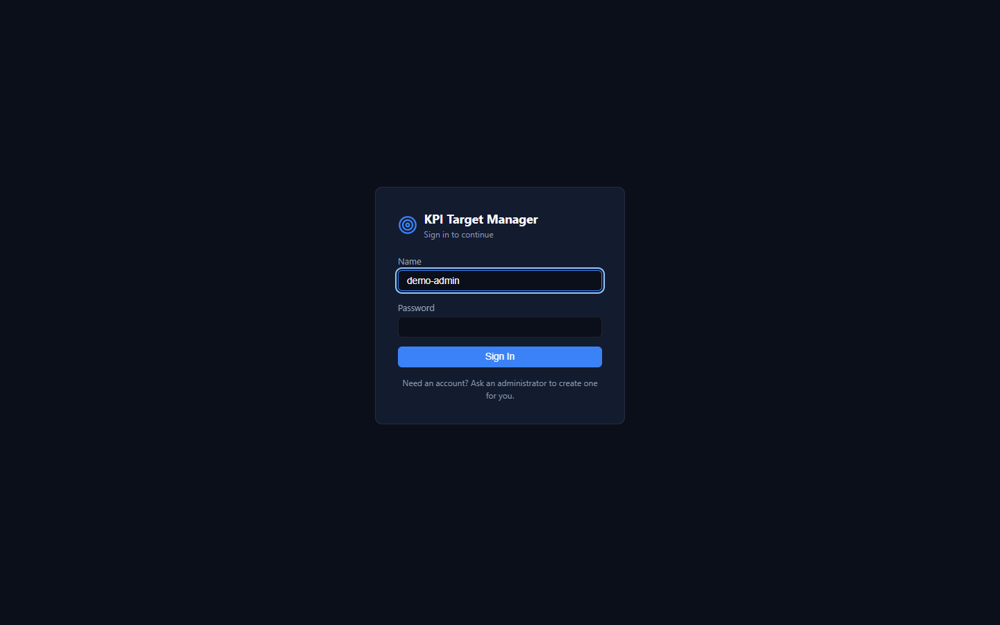

- **The first time** the app starts, it asks you to *create the first account*. That account becomes the **administrator**.
- After that, self-registration is closed. The administrator creates accounts under Data Utilities, unless the server runs with `ALLOW_REGISTRATION=true`, in which case people can register regular accounts themselves.
- Sessions last 30 days.
- Changing your password signs out your other sessions.
- Repeated failed sign-ins are throttled.

## Target Entry

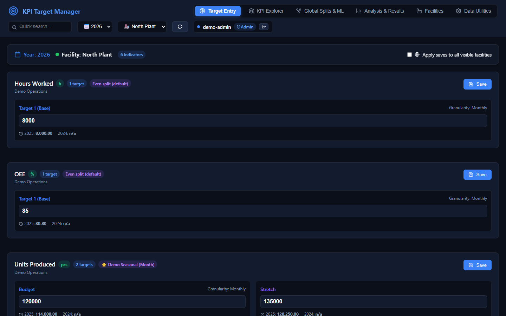

Enter the annual targets for the selected **year** and **facility**. Each KPI is a card showing:
- its unit;
- how many target scenarios it has. The names come from the KPI, e.g. *Budget* and *Stretch* instead of *Target 1* and *Target 2*;
- which split template distributes it (*Even split (default)* when there is none);
- last two years' values under each box, for reference.

How saving works:
- **Save** stores the values and immediately recalculates the day, week, month and quarter targets. It also recalculates every formula KPI that depends on this one.
- Blank boxes are left unchanged; they are never saved as 0.
- **Apply saves to all visible facilities** writes the same values to every facility, after a confirmation.
- **Formula KPIs** (e.g. *Units per Hour = Units Produced / Hours Worked*) are read-only here. Their value is calculated from their inputs whenever those are saved.

Only the KPIs enabled for the selected facility are listed. See *Facility enablement* below.

## KPI Explorer

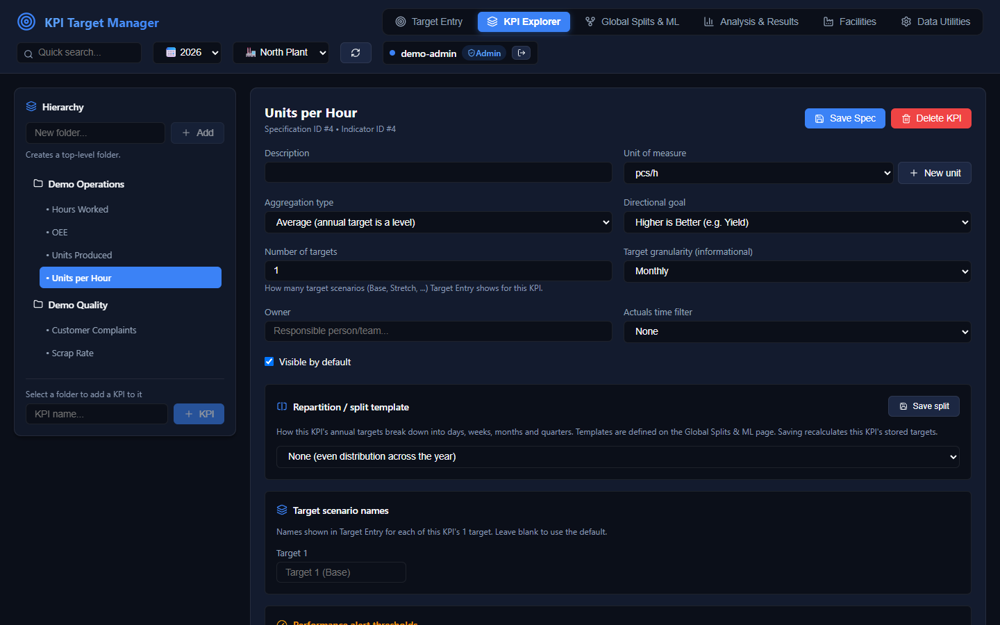

The left side is the hierarchy:
- Add top-level folders.
- Select a folder to add sub-folders or KPIs to it.

Selecting a KPI opens its definition:

| Field | Meaning |
|---|---|
| Aggregation type | **Sum**/**Count**: periods add up to the annual target. **Average**/**Last**/**Min**/**Max**: the annual target is a level, and periods are averaged, take the last day, or take the min or max. |
| Directional goal | Higher is better, lower is better, or a range. Used by the performance status. |
| Number of targets | How many scenarios Target Entry shows (1–10) |
| Target scenario names | Your own names for each scenario |
| Performance alert thresholds | Warning and error margins, relative to the target |
| Actuals time filter | Evaluate status over a rolling window of N days |
| Repartition / split template | The split template that distributes this KPI. Saving it recalculates the KPI's stored targets. |

**Formula.** A formula makes the KPI calculated:
- Use the toolbar to insert KPI references `[id]`, operators, and `abs`, `min`, `max` or `round`.
- Formulas are checked when you save: the syntax must be valid, the KPIs must exist, and there must be no self-references or cycles. An invalid formula is rejected with a message, for example *"Formula would create a dependency cycle"*.

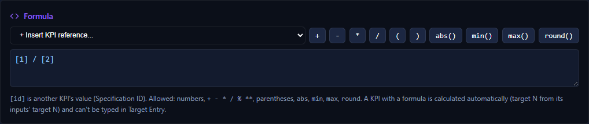

**Facility enablement** turns the KPI off for specific facilities. It then disappears from their Target Entry.

**Audit history** shows who changed which target values, with the facility and scenario names, and which definition fields changed (old → new):

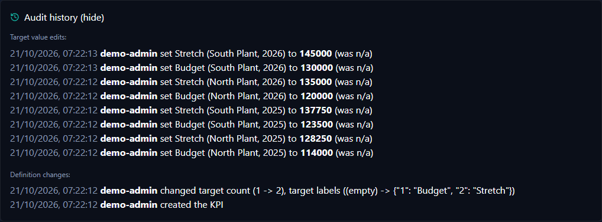

**Delete KPI** hides the KPI everywhere. Its targets and history are kept.

## Global Splits & ML

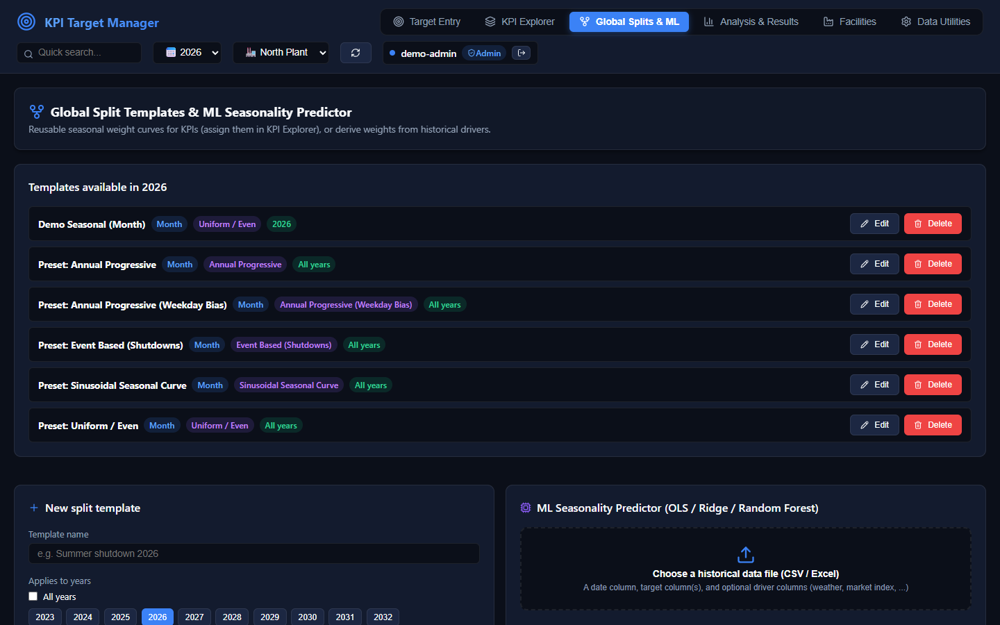

A **split template** is a reusable seasonal curve:
- **Weights per** Month, Quarter or ISO week decide how much of the year each period gets. Weights are percentages. A running total shows the sum, and weights that don't add up to 100% are scaled to 100%.
- **Day shape within each period** spreads each period over its days: uniform, progressive, weekday-biased, sinusoidal, or event-based.
- **Applies to years** limits the template to specific years, or leave it on *All years*.
- Presets are included.

You assign a template to a KPI in KPI Explorer. Editing or deleting a template recalculates every KPI that uses it; KPIs left without a template fall back to an even split.

The **ML Seasonality Predictor** derives weights from history:
1. Choose a CSV or Excel file.
2. Name the date column and the target column(s).
3. Optionally, add driver columns such as temperature, promotions or a market index.

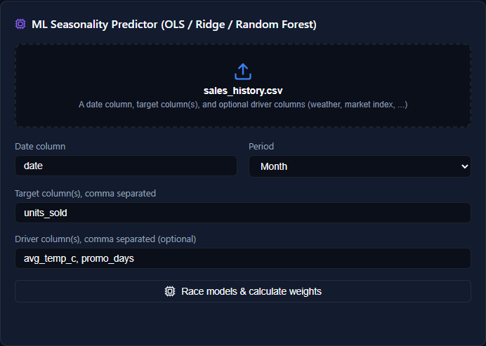

**Race models** fits OLS, Ridge and Random Forest and keeps the best one. The chart compares the historical seasonal profile with the model's fit, inside a 5–95% Monte Carlo band. **Publish as template** turns the weights into a split template for the selected year.

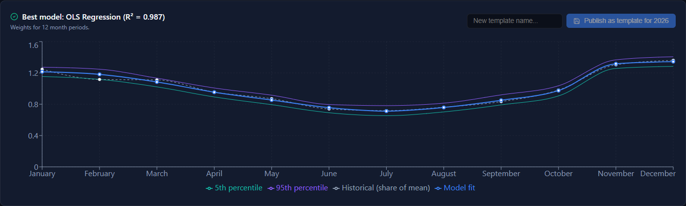

## Analysis & Results

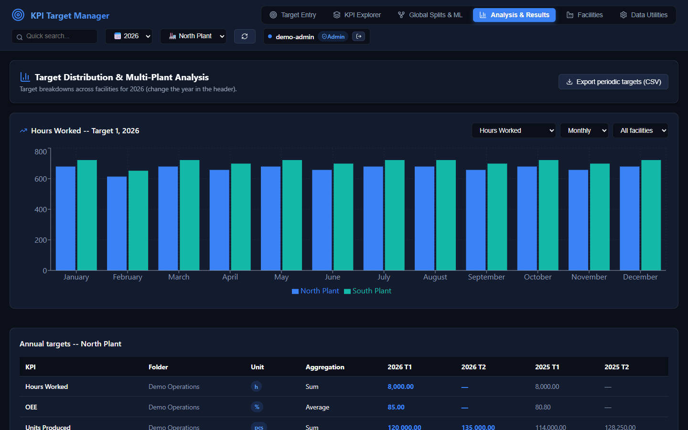

The chart shows any KPI's targets per day, week, month, quarter or year, for one facility or all of them side by side. The table below lists every KPI's annual targets for the selected facility, this year and last year. **Export periodic targets (CSV)** downloads the chart's data.

## Facilities

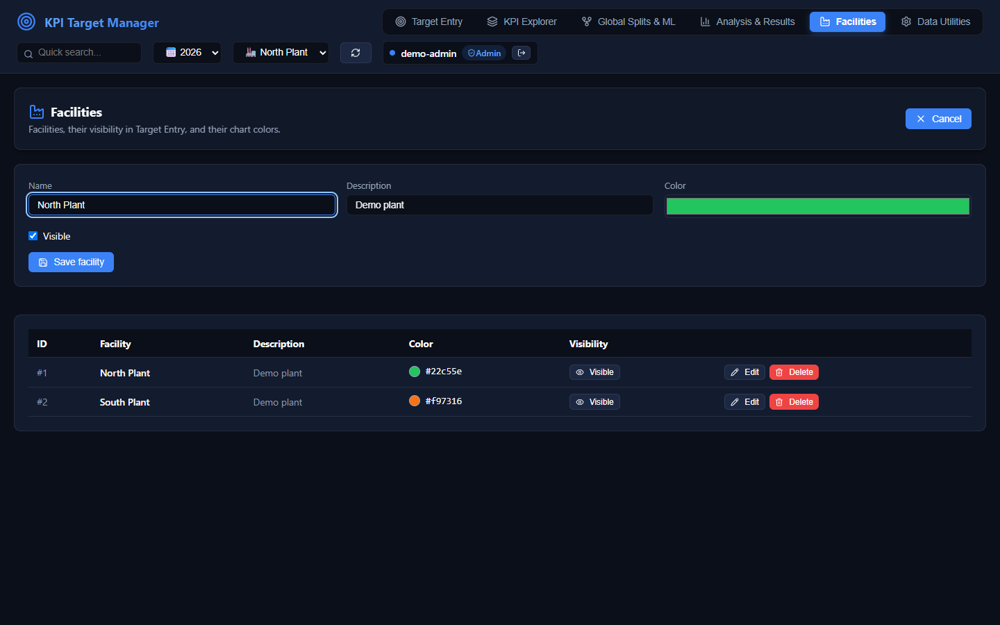

Add, edit and delete facilities and set their chart colour. Hidden facilities are skipped by *Apply saves to all visible facilities*. A facility with targets or actuals can only be deleted after a second confirmation, which also deletes its data.

## Data Utilities & Accounts

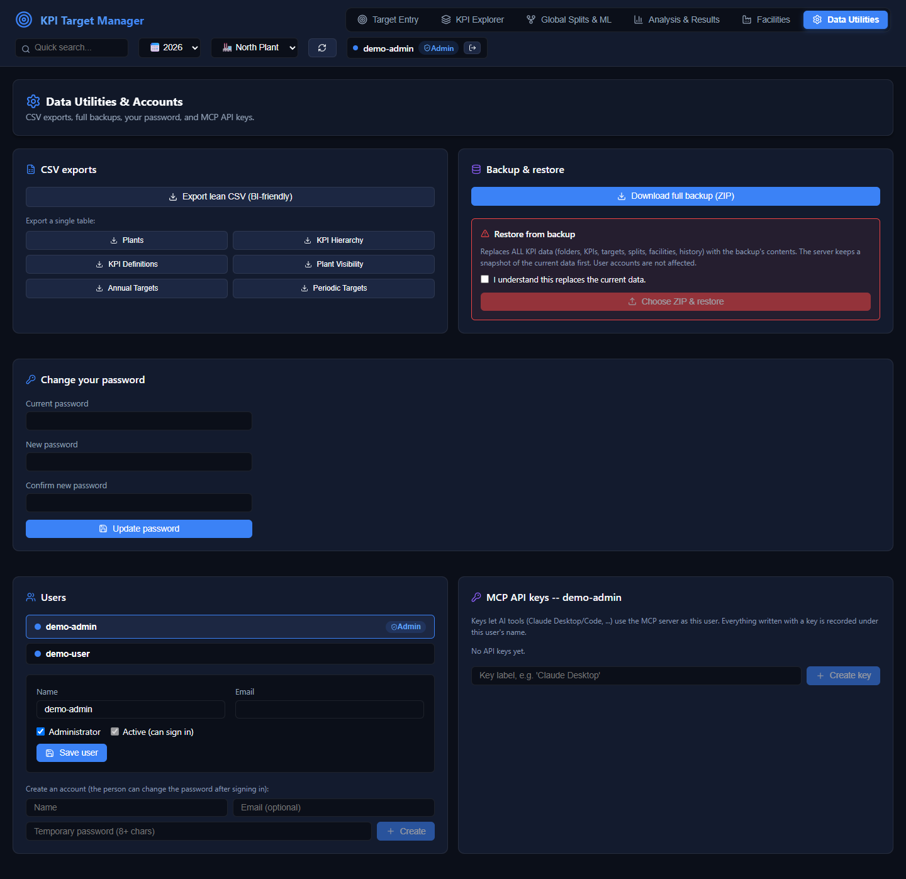

| Panel | What it does |
|---|---|
| CSV exports | Human-readable tables (plants, hierarchy, definitions, visibility, annual and periodic targets) and a lean BI export. These are not restorable. |
| Backup & restore | **Download full backup** creates a ZIP of all KPI data (user accounts excluded). **Restore** (admins only) *replaces* all KPI data with a backup, in one transaction, after saving a snapshot of the current databases to `databases/backups/pre-restore-<timestamp>/`. |
| Change your password | Requires your current password and signs out your other sessions |
| Users (admins) | Create accounts, edit names and emails, grant or remove admin rights, deactivate accounts. Deactivating also revokes the user's sessions and API keys. The last active admin can't be removed. |
| MCP API keys | Keys that let AI tools use the [MCP server](mcp.md) as you. The key is shown once. Everything written with it is recorded under your name. Admins can manage anyone's keys. |
